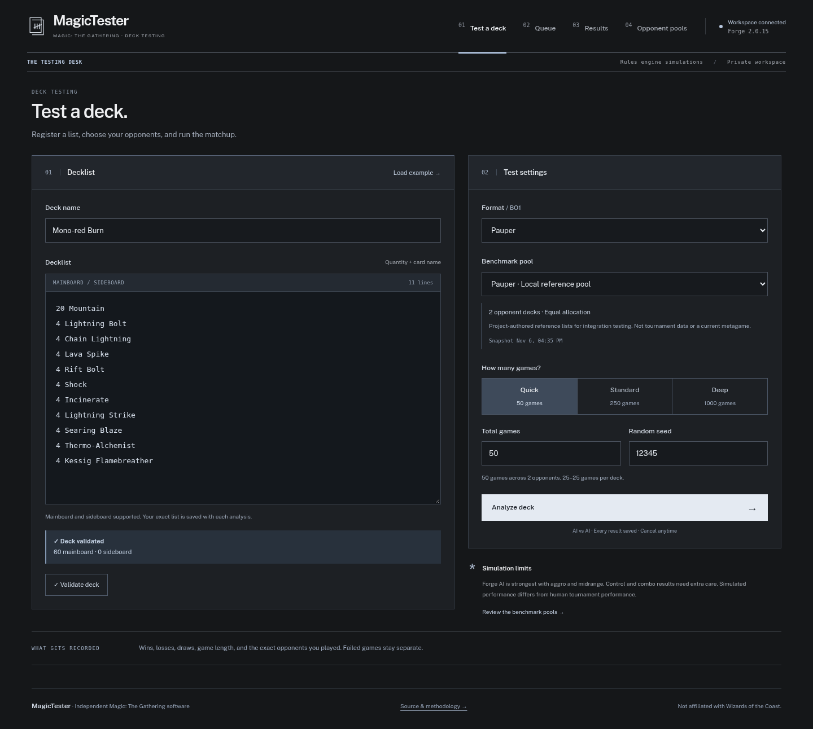

# MagicTester

A private, Docker-hosted Magic: The Gathering deck benchmark lab. Paste a deck, validate it against cached Scryfall metadata and pinned Forge card scripts, queue real AI-vs-AI games or matches, and inspect persistent results. Supports Standard, Pioneer, Modern, Pauper, Legacy, Vintage, Commander, cEDH and Duel Commander.

**No random or fabricated matchup results.** The bundled opponent pool is explicitly labeled as project-authored reference decks, not a current tournament metagame. Import your own sourced JSON/CSV snapshots for metagame testing.

**Verified:** all nine formats, native BO3, 45 local tests and clean Docker integration. The [real 1,000-game workload](docs/benchmarks/README.md) completed with zero timeouts/errors.



## Run

Requires Docker Engine with Compose v2, Internet access on first boot, and at least 4 GB RAM (6 GB recommended) and 8 GB free storage (more when Docker uses the VFS storage driver).

```sh
cp .env.example .env
# Set ADMIN_TOKEN for imports, scheduled feeds and metadata maintenance.
docker compose up --build -d --wait
```

Open **http://localhost:3000**. Choose **Load example**, validate, select the reference pool, and start a benchmark. API documentation: http://localhost:3000/api/docs.

First boot downloads the verified Forge baseline and Scryfall Oracle bulk data, then checks the latest stable Forge release. [Automatic stable updates](docs/FORGE_UPDATES.md) run hourly and validate each candidate before activation. It creates persistent caches, runs versioned database migrations, and validates/imports the reference pool. Later boots reuse those caches. Forge runs in separate Java processes behind an internal runner; it is never executed inside the API process.

The default deployment listens only on localhost and has no user authentication. All local users can view/cancel jobs. Keep it private. Add authentication and authorization before changing that deployment boundary. Set a database password and admin import token for your own deployment.

### Managed environment proxy

When your environment supplies an HTTPS inspection CA:

```sh
docker compose -f docker-compose.yml -f infra/docker/compose.managed.yml up --build -d --wait
```

The optional overlay mounts `CODEX_PROXY_CERT` (or the system CA bundle) for dependency installation and bootstrap downloads. TLS verification remains enabled. Normal installations need no overlay.

## What is implemented

- Dedicated deck parser, structured line errors, name normalization, format legality, deck/sideboard sizes, combined copy limits, card-defined copy exceptions, and Forge script availability.
- Six constructed formats plus Duel support BO1 or real first-to-two BO3; Commander/cEDH use four-player BO1 pods. Seeded games, observed starters/player turns, durations, explicit draws/timeouts/errors, process groups and deadlines.
- PostgreSQL/Drizzle schema and versioned migrations; immutable snapshot and deck records enforced by database triggers.
- BullMQ/Redis queue, job creation limits, bounded JVM capacity, progress events, cancellation, explicit retry, durable planned run identities, restart recovery, and completed-result deduplication.
- Analysis, queue, results, run evidence, benchmark browser, JSON/CSV admin import; charcoal-and-white interface with locally hosted typography. Public Sans is bundled under `apps/web/public/fonts`; system fallbacks stay on the device, and `font-src 'self'` blocks remote font downloads. No Google Fonts requests.
- Win/loss/draw records, per-opponent rates, Wilson 95% intervals, sample warnings, observed play/draw splits, and player-turn distributions.
- Authorized scheduled JSON feeds with immutable content versions, source hashes, dates, freshness and admin controls; manual JSON/CSV import remains available.
- Equal, source-share and custom weighted opponents; seeded weighted multiplayer rosters or explicit ordered pods. Exact plans and allocation methods are saved.
- Scheduled/admin metadata refresh with atomic caches and API hot reload; immutable source-hash engine builds, bounded diagnostic logs and service health.
- OpenAPI, graceful shutdown, Docker builds, CI and scheduled/manual real-engine acceptance plus 50/250/1000-game benchmark workflows.

Commander/cEDH/Duel deck validation and all companion restrictions are available. Commander and cEDH run real four-player pods with saved rosters, unique player identities, placements and commander-cast timing. Cancellation and retry preserve completed games. Duel runs at 20 life with tested commander-damage and partner-cast rules. BO3 reports game and match rates separately, native sideboard changes and actual companion selections. Interrupted match observations remain audit evidence. Sideboarding is a generic Forge heuristic, not a claim of human matchup intelligence.

## Development and verification

See the [dependency audit](docs/DEPENDENCIES.md) for current versions, Context7 migration references, security fixes and intentional compatibility limits.

Node 24 and Java 21 are used. Backend: structured Fastify/TypeScript modules (small enough to avoid a separate NestJS layer). Frontend: Next.js/React/TypeScript with plain CSS; no charting service or external state library is required. PostgreSQL access uses Drizzle.

```sh
npm ci
npm run build
npm run typecheck
npm run lint
npm test
# With Compose running:
node scripts/smoke.mjs
# After npx playwright install chromium:
npm run test:browser
node scripts/benchmark.mjs 50
BENCHMARK_RESOURCES=1 node scripts/benchmark.mjs 1000
```

The smoke test queues real games, checks SSE and results, cancels a running job, resumes it and verifies stable unique run identities. Benchmark reports are written under ignored `data/`. CI unit tests do not substitute for real-engine integration; the latter has a separate scheduled/manual workflow.

For a standalone engine spike after bootstrap, set `FORGE_HOME` and `LOG_DIR` to writable local runtime paths and run `npm run spike`. `SPIKE_CLOCK=1` exercises Forge's native clock; timed-out apparent wins are discarded.

## Benchmark import

The [reference JSON](examples/pauper-reference.json) documents the complete payload. Replace its decks and provenance with data you are authorized to import. Source URLs, date and meta share are optional; missing statistics remain null. Each import produces a new immutable version.

```sh
curl -X POST http://localhost:3000/api/v1/meta/import \
  -H 'Content-Type: application/json' \
  -H "Authorization: Bearer $ADMIN_TOKEN" \
  --data-binary @examples/pauper-reference.json
```

CSV input is a JSON object with `name`, `source`, `format: "pauper"`, and `csv`. CSV columns: `name,archetype,strategy,decklist` (quote multiline decklists). Import is disabled when `ADMIN_TOKEN` is empty.

## Reading results

Forge AI uses heuristics and is generally strongest with aggro/midrange, weaker with control and combo. **A simulated rate measures this Forge configuration, not human tournament win rate.** Win rates include rule draws as non-wins; timeouts and engine errors are excluded and shown separately. Starting player is observed rather than forced. Seeds initialize Forge's RNG but are not a guarantee of deterministic replay across builds or internal threads.

See [simulation methodology](docs/SIMULATION_MODEL.md), [Forge integration](docs/FORGE_INTEGRATION.md), [statistics](docs/STATISTICS.md), [deployment](docs/DEPLOYMENT.md), [licensing](docs/LICENSING.md), and [verification evidence](docs/VERIFICATION.md).

This independent application is not affiliated with or endorsed by Wizards of the Coast. Magic: The Gathering is a trademark of Wizards of the Coast. No card artwork is bundled.

See [opponent allocation](docs/OPPONENT_SELECTION.md), [operations](docs/OPERATIONS.md), and daily metagame [sources and feed contract](docs/sources/METAGAME.md). Configure `META_FEED_HOSTS` for trusted public sources; registration and refresh require `ADMIN_TOKEN`. Bundled reference lists do not claim to be current tournament decks.

Decks can also be imported from public or unlisted Moxfield and Archidekt links. See [deck importing and validation](docs/DECK_IMPORTS.md); the testing screen explains the checks, simulation process and what to expect.

## Standalone desktop application

The independent [desktop application](desktop/README.md) lives entirely under `desktop/`. It uses a native C#/.NET 10/Avalonia interface, SQLite and a bundled local engine worker, with no Docker or database service required. Windows/Linux builds and tagged desktop releases are defined in [the desktop workflow](.github/workflows/desktop.yml).

## Standalone Android application

The native [Android application](android/README.md) lives under `android/`. Kotlin/Jetpack Compose provides the interface, and Forge runs directly on Android ART in a separate local process. No analysis server, Docker, Node or desktop Java runtime is needed. Deck imports, current legality checks, daily opponent pools, persistent analyses, commander pairs, BO3 and readable game actions are available in the app.

See [Android setup and resource requirements](android/README.md) and [the Android build/release workflow](.github/workflows/android.yml). The workflow builds APKs, checks real games and the native interface on API 26, 35 and 37.2, and publishes `android-v*` tags. Without production signing secrets it publishes the tested debug APK as a prerelease. Debug keys can change between builds, so export saved evidence before reinstalling if Android reports a signing conflict.

AI development: the shared [decision recorder](engine-ai/README.md) provides opt-in native choice diagnostics. See the [improvement plan](docs/FORGE_AI_IMPROVEMENT_PLAN.md) and [gameplay dataset review](docs/research/MTG_GAME_DATA_REVIEW.md) for the research and evaluation criteria.
