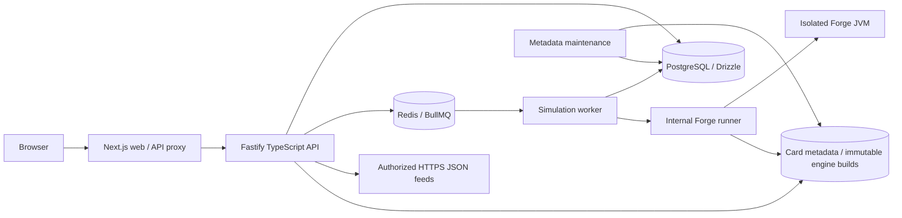

# Architecture

The API does inexpensive parsing, validation, snapshot import, job planning and read operations. It never spawns Forge. Fastify supplies explicit modules, request schemas, rate limits, structured logs and OpenAPI with less scaffolding than NestJS for this MVP. Next.js uses React and TypeScript; plain CSS makes the compact interface independent of a styling build plugin.

`CardDataProvider` loads a single cached Scryfall bulk dataset plus script names and role/ability facts extracted through the pinned Forge rules parser. Exact card names win over face aliases; tokens/emblems cannot overwrite real cards. `MetaDeckProvider` implementations normalize manual JSON/CSV imports before simulation. Each deck and opponent snapshot is immutable.

The API transaction inserts a deck version, immutable job configuration/roster and every planned run. Commander/cEDH use stable ordered pod keys in the run identity; saved rosters resolve exclusively against their immutable opponent snapshot. A stable `(job_id, opponent_id, batch_index)` identity prevents duplicate counting. The job table acts as a durable enqueue outbox. A reconciliation loop inserts missing BullMQ jobs after Redis/network interruptions. A PostgreSQL session advisory lock prevents concurrent workers from owning the same benchmark.

The worker interleaves bounded opponent batches and checkpoints each BO1 game or finalized BO3 match attempt. Multiple batches from one analysis and multiple analyses can execute concurrently, preserving absolute indices and seeds. Actual BO3 game observations are appended separately for audit, including interrupted attempts. The database indexes those observations by job/kind/time. The runner streams NDJSON results and heartbeats. Its scheduler is the global JVM bound; only one runner replica should be deployed. CPU allocation, available memory, heap budgets and operator caps govern admissions, with preference for analyses holding fewer slots. Worker requests can exceed engine capacity and wait without creating JVMs. See [deployment](DEPLOYMENT.md#parallel-analyses-and-matches) for sizing and batch settings.

Cancellation commits a flag/status, the worker aborts its HTTP stream, and the runner terminates the Java process group with SIGTERM followed by SIGKILL. Completed rows survive. On recovery, an incomplete opponent batch uses its stable per-game seed schedule; already committed run identities are skipped. Unfinished BO3 matches restart with their native history/sideboarding context rebuilt; completed match rows remain unchanged and prior game observations remain visible. This is checkpoint recovery, not mid-game continuation or deterministic replay.

The database stores normalized results, snapshots, configuration, engine build, batch seed and game index. Aggregates are computed from those results and can always be rebuilt. No calculated rate is persisted as a substitute for evidence.

Metadata maintenance performs bounded scheduled/admin refreshes outside the API. Cache publication and engine build manifests are atomic; the API loads a full replacement card provider before switching. Remote-feed imports publish new immutable snapshots. Only pending absolute unit indices are submitted on recovery, while interrupted BO3 observations remain separate audit records. See [operations](OPERATIONS.md) and [opponent allocation](OPPONENT_SELECTION.md).
