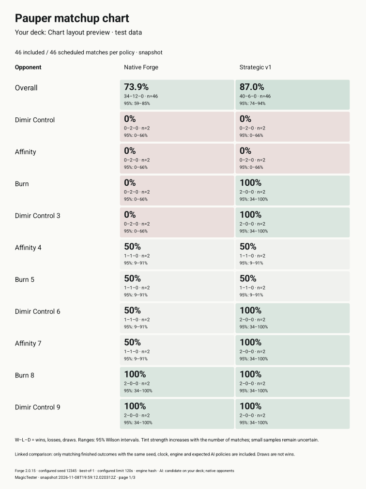

# Matchup charts · Android 0.1.11

Open an analysis in **Runs**. Its **matchup chart** expands when the run completes.
Existing saved analyses also work; no simulation rerun or database migration is
needed. A live/incomplete snapshot can be expanded while a run is in progress.

The chart uses opponent rows and your AI-policy columns, so it fits a phone.
Every cell shows a match win rate, W–L–D counts, sample size and 95% Wilson interval.
Tint uses the win rate and sample size: muted teal for more wins, rose for fewer,
and neutral cells when there are no finished results. Tap a cell to inspect the
counts, unfinished work, unpaired results and earlier unsuccessful attempts.

- Rates are wins divided by finished matches. Draws are finished matches but not
  wins. Timeouts and invalid/incomplete attempts are not losses.
- Each scheduled match index contributes once. A successful retry replaces the
  earlier unfinished outcome; best-of-three evidence counts as one match.
- Opponent assignment uses the same frozen-pool schedule as the simulation
  request. Unscheduled opponents have no invented rate.
- Linked Native/Experimental charts use only the same verified matched indices
  as the comparison summary. Different clocks, engines, seeds or AI evidence are
  excluded. The chart says when it can show only one analysis.
- Multiplayer Commander rows represent whole opponent pods in their actual seat
  order. A pod win is not counted as a separate head-to-head win against each
  deck. Tap its cell for the full opponent roster.

**Save matchup chart (PDF)** opens Android's file picker. The export uses a light
paper layout, includes every matchup across as many pages as required, and adds
full pod/long-name rosters when needed. It records the snapshot time and analysis
settings. Fonts are installed Android fonts; the chart and export fetch no fonts,
images or chart data from external services. No charting dependency was added.

The chart measures your deck against its recorded opponents. It does not fill in
unplayed pool-versus-pool matches or represent a complete metagame round robin.
Small samples can have very wide intervals even when a cell says 0% or 100%.

Verification covers retry/draw handling, missing and malformed outcomes, schedule
wrapping, multiplayer pods, matching-pair exclusions, confidence intervals,
best-of-three counts, paginated PDF rendering and phone Back from cell details.
The release workflow retains chart/PDF previews with its Android acceptance
artifacts. Screenshot previews use clearly labelled synthetic test data.

## Verified release

[Android 0.1.11](https://github.com/acocalypso/magictester/releases/tag/android-v0.1.11)
was published from commit `527ab01`.
[Acceptance workflow](https://github.com/acocalypso/magictester/actions/runs/42516994215)
passed 26 JVM tests, lint, shared/native AI checks, and 6 UI plus 50 engine/runtime
tests on each of API 26, 35 and 37.2. In-place upgrade and private-data retention
checks passed. These are emulator checks, not a physical OnePlus device test.

The downloaded published APK was independently checked:

- Version: 0.1.11 / code 112.
- APK SHA-256: `70edad61248ff3f92f5e77ea93477ff61ebc411c74e353d759f43774eeed9e4a`.
- Signing certificate SHA-256: `a12aa61ccbe6ceb0973da544ce5b09dc07a50306afe8338ca61c356fe5f68f07`.
- Engine JAR SHA-256: `137d5a8948620a7c2ebd7d9908f61b08e2d0be2e4f999dea49102c033ec60466` (unchanged from 0.1.10).

Actual Android PDF rendering, first of three pages, with **synthetic test data**
for layout verification. Its percentages are not an AI benchmark or user run:

